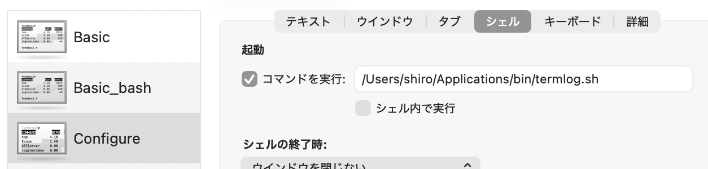

# terminal_logging

Teraterm などのターミナルソフトウェアと異なり、macOS の Terminal.app では実行したコマンドやその出力などを明示的なログファイルの形では残してくれません。

スクロールバッファについては自動的に記録が取られており、デフォルトの状態だと Terminal.app を再起動しても残ってはくれますが、うっかり Command-K を押してクリアしてしまったり、行数制限をかけている場合はその限りではありません。

script コマンドを実行することでログファイルには取られますが実行を忘れてしまうこともあります。

あと、細かいことですが script で残したログにはそれが出力された日時が残っていないためいつ実行したかが分からなくなることがあります。

そこでちょっとした小細工である程度マシにするのがここでの目的になります。

## Configure.terminal

Terminal.app では複数の Profile を定義でき、どの Profile のウィンドウを開いたかで起動するシェルやウィンドウサイズ、色などの構成を変えることができます。

ここでは、Configure という名前の Profile を用意し、以下を設定しています。

- スクロールバッファを「使用可能なメモリに制限」に変更
- 起動するコマンドを次の termlog.sh に変更
  - シェル内で実行のチェックを外す



- ウィンドウのタイトルの以下にチェックをしない
  - 作業ディレクトリまたは書類
  - 動作中のプロセス名
- 【任意】区別のため、ウィンドウの色を変えておく
  - 私は、普段のターミナルが黒地にオレンジの文字という色彩のため、こちらは白地に黒にしました

ログを取りたいときはこの Profile でターミナルを開きます。
ウィンドウを開くたびにファイルが増える、スクロールバッファでメモリを取られ続けるので常用は避けた方がいいです。

## termlog.sh

上記の Profile で Terminal.app のウィンドウを開くと、まずこのスクリプトが実行されます。

以下のことを行います

1. ログの格納先を確認、なければフォルダを作ります。
2. 以下の環境変数を設定します
  - PTZ : zsh の場合のプロンプトに含める日時の文字列
  - PTB : bash の場合のプロンプトに含める日時の文字列
3. exec にて script コマンドを実行、ログの格納先に日時のファイル名でログファイルを作ります
4. script コマンドがログインシェルを起動します

script コマンドの実行ですが、以下になります。

- 付属の FreeBSD 由来の script を特定のパスに配置した場合はそちらを使います。
  - パスは termlog.sh の BSDSCRIPT 変数に書いてますので適宜直してください
  - FreeBSD 由来の script を使う場合は -w オプション(SIGWINCH を子プロセスに伝達する)を同時にオンにします

- 付属の ttl がスクリプトのパスある場合は、ttl を script のフィルタとして利用します
  - ttl はエスケープシーケンスを削除し行頭にミリ秒までの日付を入力するツールです  
- ttl がない場合は単純にログファイルへ書き出しております。

## zshrc_piece

zshrc / bashrc に含めておくべきスクリプトになります。  
なお、私は zshrc と bashrc を同一ファイルのシンボリックリンクにしております。特有の部分は ZSH_VERSION の有無などで分岐し、どちらでも解釈できるようにしている次第です。

そもそも bash を使っていたのが、macOS での bash の非推奨に伴って致し方なく移行をしたため、そうなっております。

さて、この piece では以下のことを行っています。

1. コマンドプロンプトの設定

もともとコマンドプロンプトを設定していた部分で、環境変数 PTB , PTZ があったらプロンプトの先頭に加えるようにしています。これらは termlog.sh で設定されています。

2. PTZ / PTB があった場合、OSC7 の出力をやめさせる

OSC7 (Operating System Command 7) はシェルからターミナルエミュレータに対してカレントディレクトリを通知するエスケープシーケンスです。macOS のシェルではプロンプトを出すたびに OSC7 で file:// からなる URL でカレントディレクトリを出力、受け取ったターミナルエミュレータはカレントディレクトリを認識、ウィンドウのタイトルの作業ディレクトリの更新などに使用されます。

ターミナルのウィンドウにこの OSC7 の URL は表示されませんが、script コマンドのログには含まれてしまいとても鬱陶しいことになります。  
そのため、zsh/bash のプロンプトの設定を操作して OSC7 の出力を止めています。
ttl を使用する場合は ttl にて削除されるため鬱陶しいことは回避されるはずですが、念のため外したままにしております。

副作用としてウィンドウのタイトルに作業ディレクトリを表示していると更新されなくなります。このため、Configure.termianl でウィンドウのそれらの表示のチェックを外しております。


## ttl/ttl.c

Claude にちゃちゃっと作らせた行単位でエスケープシーケンスを排除するコードに手動で日付を入力するコードを足したものです。  
日時はミリ秒の単位まで出力されます。(TeraTerm Pro 互換)

また、ttl を使っているときだけシェルのパイプを完全に排除できるので動作するプロセス数が少なくなります。
script はファイルしか引数にとれないのですが bash/zsh の >() にて他のコマンドへ出力をつないでます。exec により元のシェルを script にするのでプロセスを一個節約できてます。  
しかし、>() のなかで、ansifilter を使う場合は ansifilter と gawk が、そうでない場合は sed, col, gawk がパイプでつながれているためパイプのハンドリングでシェルが一個居続けてしまいます。  
ttl を使う場合はパイプを全く使わないのでハンドリングのためのシェルが一つもいない状態になります。

なお、最もプロセスがつく無いのは script だけを使う場合になります。ただ、この場合ログの行頭に日時が記録されなくなり、エスケープシーケンスやらも残った状態になります。

## bsdscript/script.c

macOS の script コマンド、すなわち古い *BSD での script コマンドは -w オプションがなく、ターミナルのウィンドウのリサイズを子プロセスへ伝達しません。  
FreeBSD の script ではこの点が修正されており、 -w オプションを追加することで子プロセスへ SIGWINCH を伝達します。

このため以下から FreeBSD の script コマンドを取得、macOS でビルドできるようにだけ修正を加え、これを利用するようにしました。
[https://raw.githubusercontent.com/freebsd/freebsd-src/refs/heads/main/usr.bin/script/script.c](https://raw.githubusercontent.com/freebsd/freebsd-src/refs/heads/main/usr.bin/script/script.c)

修正したことは以下の2点です。

- FILEMON 関連の機能のコメントアウト
- libutil.h ではなく util.h を include

macOS には FreeBSD にある FILEMON の機能そのものはないので IFDEF で無効化しました。  
なお、以下にある Darwin での script.c でもほぼ同等の修正がされております。
[https://raw.githubusercontent.com/apple-oss-distributions/shell_cmds/b33f386ac431f17d4799b5662f20ff2ddf0773b9/script/script.c](https://raw.githubusercontent.com/apple-oss-distributions/shell_cmds/b33f386ac431f17d4799b5662f20ff2ddf0773b9/script/script.c)

Makefile は用意していないので、Command Line Tools か Xcode をインストール後、以下コマンドでビルドしてください。

```
cc -o script -lutil
```


## 考えるべきこと

### ログファイルの清掃

このままだとログの格納先にログファイルが溜まっていきます。

現在は手動で清掃していますが、自動化は考えるべき。

